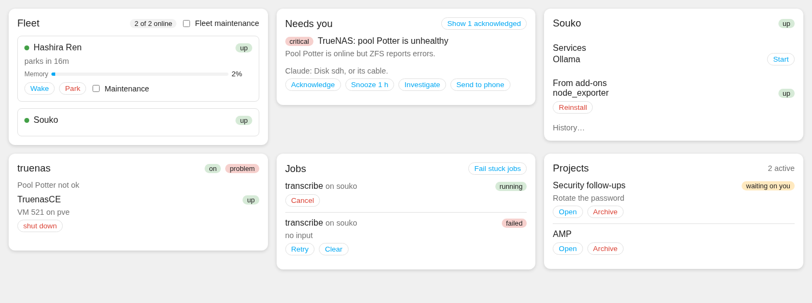

# Hisho cards for Home Assistant

A dashboard for [Hisho](https://github.com/YepizTechJonathan/hisho-ha): cards with the controls of Hisho's
own Command Center, and a **Hisho dashboard** Home Assistant builds by itself from your fleet.



Needs the **Hisho** integration ([hisho-ha](https://github.com/YepizTechJonathan/hisho-ha), v1.2.0 or later),
paired with Hisho. The cards talk only to Home Assistant (its entities and the `hisho.*` services), never to
Hisho directly, so no Hisho key is ever in your browser. What they offer follows what Hisho lets this Home
Assistant do; risky actions (park, stop, shut down, archive...) ask first. They are for Home Assistant
**administrators**: a regular user sees a notice instead (and the integration refuses their presses anyway).
Make the Hisho dashboard admin-only too: Settings › Dashboards › Hisho › *Admin only*.

## The Hisho dashboard

Settings › Dashboards › **Add dashboard** › **Hisho** (on Home Assistant versions that list custom
dashboards there). Otherwise: Add dashboard › *New dashboard from scratch* › open it › ⋮ › *Edit dashboard* ›
⋮ › *Raw configuration editor*, and paste:

```yaml
strategy:
  type: custom:hisho
```

Views: **Overview** (a greeting with the day and one sentence on how things are, status badges, live tiles with
their last 24 hours, machines, needs you, jobs), **Machines**, **Devices** (servers, VMs,
storage...), **Add-ons**, **Projects**, **Conversations** (what people asked Hisho through Assist, 30 days;
needs the hisho integration 1.8.0), **Phone**. It follows your fleet: a new machine or box appears on its
own. To change it, ⋮ › *Take control* and edit it like any dashboard.

### The look

Dark glass cards over a misty pine forest at dusk, with forest green and warm brown accents. The picture comes with
the Hisho integration (v1.7.0 or later, served at `/hisho_static/forest.jpg`; without it the dashboard shows the same
colours as a gradient). To use a photo of your own, put it in `config/www/` and give the strategy its address:

```yaml
strategy:
  type: custom:hisho
  background: /local/my-photo.jpg   # or "" for no picture
```

With [card-mod](https://github.com/thomasloven/lovelace-card-mod) installed, Home Assistant's own cards on the dashboard
(Today's list, the calendar, the phone settings) wear the same glass. A theme can change the accents through
`--hisho-theme-accent`, `--hisho-theme-brown` and `--hisho-theme-glass`.

## Cards

| Card | Shows | Does |
|---|---|---|
| `custom:hisho-fleet-card` | every machine: state, readings, parking | wake, park, maintenance (machine and fleet) |
| `custom:hisho-machine-card` (`machine: Souko`) | one machine in full: readings, services, add-on items | wake/park, start/stop/restart services, add-on buttons, maintenance |
| `custom:hisho-needs-you-card` | Hisho's needs-you list with Claude's findings | acknowledge, snooze, investigate, send to phone |
| `custom:hisho-device-card` (`device: truenas`) | a box an add-on knows, or an add-on | its add-on buttons (VM start/shut down...), maintenance, add-on on/off |
| `custom:hisho-jobs-card` | jobs | cancel, retry, clear, fail stuck jobs |
| `custom:hisho-projects-card` | active projects, what waits on you | open, archive |
| `custom:hisho-conversations-card` | what people asked Hisho through Home Assistant (30 days): who, room, time in Hisho's owner time zone, the first question; a tap opens the transcript | filter by person, delete (asks first) |

Every card takes `title:`; the jobs, projects and conversations cards take `limit:`. Like every Hisho card,
the conversations card is for Home Assistant administrators only (the integration refuses anyone else).

## Install

HACS › ⋮ › **Custom repositories** › `https://github.com/YepizTechJonathan/hisho-ha-cards`, type
**Dashboard** › **Add**, then find **Hisho cards** › **Download**. HACS adds the resource; reload the browser.

By hand: copy `dist/hisho-ha-cards.js` to `config/www/`, then Settings › Dashboards › ⋮ › Resources ›
add `/local/hisho-ha-cards.js` as a JavaScript module.

## Development

```bash
npm ci
npm test            # vitest, cards against a fake hass shaped like the real integration
npm run typecheck
npm run build       # dist/hisho-ha-cards.js (commit it: HACS serves it)
cp <hisho-ha>/custom_components/hisho/www/forest.jpg demo/   # the picture, for the demo pages
node demo/build-demo.mjs && (cd demo && python3 -m http.server)   # every card with fake data
NODE_PATH=$(npm root -g) node art/forest.mjs forest.jpg 2560 1440  # redraws the picture (Playwright)
```
